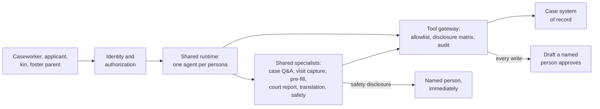

# Child Welfare Agency: Agency AI (prototype)

A working prototype of human-led AI for child welfare. It covers four people: a **caseworker**, a **prospective foster or adoptive parent**, a **kin caregiver** and a **licensed foster parent**. All names, cases and data are fictional. Children appear as illustrated avatars, never photos. It is not an official product of any agency or vendor.

## Problem statement

Child welfare runs on paperwork, and the people it serves pay for that in time and trust.

- **Caseworkers are buried in documentation.** Under 35% of caseworker hours go to children and families (Pennsylvania time study). Caseloads can reach about 45 per worker against a recommended 12 (NHPR). Workload and paperwork are a main reason workers leave (University of Hawaiʻi, QIC-WD), and turnover delays permanency for children.
- **Kin caregivers are placed in hours but paid after months.** Licensing averages about 160 days, and many states pay nothing until it's done (Family Ties). Caregivers delay their own health care and home repairs to cope (GAO, 2025).
- **Prospective and foster parents leave because nobody answers.** Not hearing back from staff is one of the most consistent complaints, and over three-quarters of families hit a barrier (AdoptUSKids). Waits go unexplained, information at placement is thin, and adoption can take years.

The full evidence (68 public sources in 22 themes) is in the persona canvas, `canvas/index.html`, under "Voices from the field". Check the original sources before quoting a number.

## Social impact

- **More time with families:** every hour of documentation the AI drafts is an hour a worker can spend on visits, safety planning and finding relatives.
- **Fewer workers leaving:** lighter workloads and better support keep experienced workers, so children have fewer caseworker changes.
- **More children with family:** faster kin approval and support from day one make relative placements more likely to hold.
- **More homes, kept longer:** parents who know who holds each step, who to call and when they'll hear back are less likely to drop out.
- **Fairer records:** a language check flags blaming words before they enter a permanent record that follows a family into court.

## Objective

Give caseworkers time back and give families clear, timely answers, without letting AI make any decision about a child.

## Goals

| Goal | Measured by |
|---|---|
| Return documentation time to caseworkers | Hours of documentation and after-hours work against a baseline taken before launch; time from visit to signed note |
| Drafts workers can trust | Approval rate of AI drafts; edit similarity between draft and signed version |
| Families never left waiting | Share of messages answered within the 2-business-day deadline; escalations to supervisors |
| Faster support for kin | Days to kin approval against a 90-day target; time to first support |
| Safe by design | Zero cross-case or cross-family leaks; safety disclosures always reach a person; no AI decisions on placement, custody, eligibility or risk |
| Kind, plain answers | Helpfulness and politeness/empathy scores from an LLM judge, checked against human grades |

## Solution options and phases

| Option | What it is | Verdict |
|---|---|---|
| 1. More staff and process change only | Hire workers, simplify forms | Needed but slow and budget-bound. Software can't hire workers, but it can return their time |
| 2. Point AI tools | A standalone transcription app or chatbot | Quick, but it adds another place to re-enter data and has no shared permissions or audit |
| 3. Predictive risk scoring | Models that score families or rank children | **Rejected.** It encodes historical bias, is hard to defend in court and takes decisions away from people |
| 4. **Human-led AI platform** *(chosen)* | One AI layer inside the case system: drafts a person approves, permissions in a gateway, evals before release | Works across every module, keeps people in charge and can be audited |

| Phase | What's built | Exit test |
|---|---|---|
| 0. Foundations | Tool gateway, authorization, audit log, eval harness, safety detection | A red-team run finds no cross-case or cross-family leak |
| 1. Relief and trust | **Caseworker:** visit capture to draft note, form pre-fill, language check, court report assembly, case chat, caseload assistant, workload view. **Families:** who holds each step, who to call, reply deadlines with escalation, payments explainer, care needs. **Kin:** help available before licensing, approval progress | Visit-to-signed-note time falls; messages answered within the deadline; kin time to first support falls |
| 2. Knowledge | Law and policy Q&A per state, family finding with translation, document intake, benefits applications | Citation accuracy meets its bar in each launch state |
| 3. Highest stakes | Placement and long-term path explainers, compliance watcher, aggregate analytics | Counsel and supervisors sign off |

## Why adopt AI, and where not

**Where AI helps:** work that is heavy on text, repetitive and quick for a person to check.
- Turning a recorded visit into a draft note, with every line tied to a transcript time.
- Filling forms from what's already in the record, showing the source for each field.
- Answering "what did the child say about visits?" with a citation, instead of opening five screens.
- Explaining status, payments and next steps to families in plain language, any time of day.
- Translating outreach so relatives hear from the agency in their own language, with a bilingual check.

**Where AI does not belong:** decisions about placement, custody, removal, reunification, eligibility, approval or risk, and any score or ranking of families or children. The law assigns these to people, and they are where bias does the most harm. Rules, not the model, decide what is urgent, and the model only explains.

**Why now:** current models can draft, extract and explain reliably enough to save real time, *if* they are wrapped in permissions, citations, human approval and evals. This prototype is mostly that wrapper.

## AI architecture

Full design, decisions and rejected alternatives: [`docs/ai-architecture.md`](docs/ai-architecture.md).



- **One runtime, an agent per persona, shared specialists.** Permissions and tone differ by who is asking. Safety, law and translation logic must give one answer for everyone.
- **Authorization in a tool gateway,** checked per call with the user's identity. A disclosure matrix removes restricted fields (for example the reason for removal) before the model sees them.
- **Every write is a draft** that a named person approves. The court report's recommendation is always the worker's own text.
- **Workflows for high-stakes outputs** (visit note, pre-fill, court report) and an agent loop only for open questions.
- **Cite or abstain.** Every claim names its source; "not in the record" is a correct answer.
- **Four guardrail checkpoints:** input (safety disclosure, prompt injection), retrieval (permission, jurisdiction), output (no decisions, no legal advice, reading level, blaming language) and action (draft only, approval, rate limits).
- **Evals and tracing:** a 49-case golden set that blocks a release on any critical failure, LLM judges for helpfulness and empathy, and Braintrust traces with approval and edit signals from production.

## Next phases

1. **Real speech to text** for visit capture, with consent and speaker labels. Transcripts are seeded today.
2. **Law and policy Q&A per state:** hybrid keyword and vector search, with jurisdiction and effective-date filters, and a golden question set written with counsel.
3. **SMS and phone channel for kin**, with answers short enough for a text.
4. **Persistence and sign-in:** a hosted database, per-user memory and rate limits.
5. **Integration with state systems** so drafts flow in without double entry.
6. **Validate the judges** against human grades, add Spanish safety and quality cases, and measure edit distance on real signed notes.
7. **User research** on the stages with the least evidence: the kin long-term path, accepting a new case and court preparation.

## What's in the prototype

- **Agency AI home** (default landing for caseworkers): a full-screen chat over the whole caseload. "Your day" cards are color-coded by urgency (red urgent, amber soon, blue routine). Tap a card to ask about it, or ask anything about any child. Answers name the child and link to their case. The sidebar holds My cases.
- **My cases** (sidebar): the case list. It has a case list with filters, a "Your day" briefing, and case and child pages. **Ask Agency AI** reads the current case, names its stage and suggests next actions you can pin and reorder, then lets you ask about the case. Use **Full screen** in the panel header for a two-column view, with actions on the left and a wide chat on the right. The chat box grows as you type: Enter sends, and Shift+Enter adds a new line.
- **Journey study** (top menu): the original 21-screen concept walkthrough from the persona canvas (`canvas/index.html`).
- **Viewing as** (top left): stands in for sign-in. Choose one of three caseworkers, a kin caregiver, a licensed foster family or an applicant family. A one-time tip points it out on first load.
- **Workspace** (top left, next to Viewing as): every Agency AI chat for every persona, saved in this browser only. Switching personas or reloading keeps each persona's history. Nothing is shared with other viewers, because the server doesn't store chats in workspace mode.
- **Internal use** (top right): the three Journey study walkthroughs and the AI quality drawer. These are internal, not part of the end-user product.

The design is in `docs/ai-architecture.md`, and the agent profile is in `AGENTS.md`.

## Run it locally
```bash
python3 dev.py            # http://localhost:3000  (static site + /api on one port)
```
```bash
python3 dev.py --reseed   # rebuild the SQLite database from cwa/seed.py
```
```bash
python3 -m unittest discover -s tests -v
```
```bash
python3 evals/run_evals.py      # 49-case golden eval set (see evals/README.md)
```
You need Python 3.10 or later. The backend uses only the standard library. The one optional package, `braintrust`, is for logging and eval experiments (below).

## Turn on the live model (DeepSeek)
Without a key, the app runs in **scripted mode**. It uses the same gateway, rules and guardrails, and fills in the wording from templates. With a key, the persona agents call DeepSeek with tool calling.

1. Create a key at **platform.deepseek.com**, under API keys. Don't paste it into chat, code or a commit.
2. **On Vercel:** go to Project, then Settings, then Environment Variables, and add `DEEPSEEK_API_KEY`. Tick Production and Preview. Optionally add `DEEPSEEK_MODEL` (default `deepseek-chat`). Then go to **Deployments** and redeploy the latest one so it picks up the variable.
3. **Locally:** copy `.env.example` to `.env`, paste the key, and run `python3 dev.py`. `.env` is git-ignored.
4. Check that it worked: the blue bar shows **AI: live · deepseek-chat**, or open `/api/health`.

Only fictional data is in this prototype. Before any real data goes to a model vendor, settle the vendor's terms and data residency. This is open question 3 in the architecture doc.

## Logs and evals in Braintrust (optional)
With `BRAINTRUST_API_KEY` set and `pip install -r requirements.txt`, the app sends every AI request to the Braintrust project `child-welfare-agency` (override with `BRAINTRUST_PROJECT`). Without the key, nothing is sent and nothing changes.

- **Production logs (`cwa/observability.py`):** one trace per AI request: chats (named `chat · <persona>`, tagged `chat`, with just the message as input and the reply as output), workflows, family messages and draft decisions. Each chat trace carries `metadata.conversation_id` (one random id per browser chat thread) and `metadata.turn_number`, so a whole conversation can be grouped or scored together. Opening the AI panel and page loads aren't traced. Each trace has a span for every model call, with token counts, and for every gateway tool call, with the policy decision and the field names returned. It also gets three human signals: draft ratings (`viewer_rating`), approve or reject (`approved`), and how much the worker changed the draft before signing (`edit_similarity`). A safety disclosure is logged as `[redacted: safety disclosure]`. `BRAINTRUST_LOG_CONTENT=false` logs metadata only. Logging failures never break a request.
- **On Vercel:** add `BRAINTRUST_API_KEY` under Settings, then Environment Variables, and redeploy. Vercel installs `requirements.txt` on its own.
- **Evals as experiments:** `python3 evals/braintrust_eval.py` runs the golden set and records one experiment per run, with `golden_pass`, `critical_gate` and a pass score per persona (`caseworker_pass`, `kin_pass`, `parent_pass`). Chat cases are also graded by an LLM judge for `helpfulness` and `politeness_empathy` (`evals/judges.py`), using the rubric in the "Helpful and kind" section of `AGENTS.md`. The judge is Claude (`claude-opus-5-5`, official `anthropic` SDK) when `ANTHROPIC_API_KEY` is set, otherwise DeepSeek with `JUDGE_API_KEY` or `DEEPSEEK_API_KEY`. Install the eval packages with `python3 -m pip install -r evals/requirements.txt`. To save the two judges as scorers in the Braintrust library (for online scoring of production logs), run `braintrust push evals/braintrust_scorers.py --if-exists replace`. Answers stay scripted unless you pass `--live`. Add `--live` to use the model, or `--local` to try it without sending anything.
- **CI:** `.github/workflows/evals.yml` runs the unit tests and the golden gate on every pull request and push to main. If the repo has a `BRAINTRUST_API_KEY` secret, it also records the run in Braintrust.

## Deploy on Vercel
1. Import the GitHub repo at vercel.com/new. Framework preset: **Other**. Leave the build command empty.
2. Vercel serves the static files and runs `api/index.py` (Python) for `/api/*`, as configured in `vercel.json`.
3. If viewers are asked to log in, turn off **Deployment Protection** for production.

**Data on Vercel:** Vercel's file system is read-only, so the database is seeded into `/tmp` when an instance starts. Chat history, memory and approvals last while that instance stays warm, then reset to the seed data. Locally, they persist in `data/cwa.db`. For persistence on Vercel later, point `cwa/db.py` at a hosted database such as Turso or Postgres.

## How it fits together
```
index.html, app.js, screens-*.js   journey walkthrough (unchanged)
cases.js, cases.css                case list, case page, application, Agency AI panel
api/index.py                       Vercel entry point -> cwa/api.py (WSGI, no framework)
cwa/
  seed.py        schema + fictional data (12 children, 3 caseworkers, 2 supervisors, kin caregiver, foster family, applicant)
  gateway.py     tool gateway: persona allowlist, schema checks, scope, disclosure matrix, audit, proposals
  stages.py      case stage + next-action rules (explainable, tested)
  agent.py       persona runtime: AGENTS.md profile + skills + DeepSeek tool loop + scripted fallback
  workflows.py   fixed-step workflows: briefing, visit note, form pre-fill, language check, first contact, triage, application help
  guardrails.py  safety disclosure, prompt injection, emotional cues, decision/legal-advice output checks, fault language
  llm.py         model gateway (DeepSeek, OpenAI-compatible)
  skills.py      loads skills/<name>/SKILL.md
AGENTS.md                          core agent + four persona profiles (tone, emotional states, tools)
skills/<name>/SKILL.md             18 skills (Agent Skills format) with their allowed tools
tests/test_backend.py              permissions, disclosure, stages, guardrails, workflows, live tool loop (fake server)
evals/golden.json, run_evals.py    49-case golden eval set and runner (release gate on critical cases)
```

### Why a plain Python WSGI app over SQLite
- **One deploy:** Vercel serves the existing static front end as-is and runs one Python function for `/api`. There's no build step and the front end needs no rewrite.
- **No dependencies:** Python's standard library covers HTTP, SQLite and JSON. Cold starts stay fast, and there's nothing to install or patch.
- **Easy to move:** the same `app` runs under `dev.py`, Vercel, or any WSGI host such as gunicorn on Render or Fly if you later need a persistent database.
- **Trade-off:** there's no request validation framework, so the gateway does its own schema checks (section 4 of the architecture). If the API grows, FastAPI is the natural next step.

## API (all JSON; identity from `X-Persona` and `X-User` headers)
| Method and path | What it does |
|---|---|
| `GET /api/health` | Mode (live or scripted), model and seed date |
| `GET /api/people` | Options for the "Viewing as" switcher |
| `GET /api/cases` | Case list rows: child, age, stage, next due, flags, last visit |
| `GET /api/cases/{id}` | Case page (caseworker), or the kin or foster view filtered by the disclosure matrix |
| `GET /api/briefing` | Start-of-day briefing |
| `POST /api/ai/open` | Opens Agency AI on the current object: stage, next actions, saved chat, memory |
| `POST /api/ai/chat` | Sends a message to the persona agent |
| `POST /api/cases/{id}/actions/{aid}` | `pin`, `unpin`, `up`, `down`, `done` or `dismiss` a suggested action |
| `GET /api/workload` | Caseworker workload strip and supervisor recognition |
| `POST /api/messages` | A family message to their worker, with a reply deadline and supervisor escalation |
| `POST /api/workflows/{visit-note,prefill,language-check,court-report,first-contact,inquiry-triage,application-help}` | Runs a workflow; writes become proposals |
| `POST /api/proposals/{id}` | A person approves (and may edit) or rejects an AI draft |
| `POST /api/feedback` | A viewer's rating of a draft (`proposal_id`) or answer (`trace_id`), sent to Braintrust |
| `GET /api/audit?case_id=` | Gateway audit log for a case |
