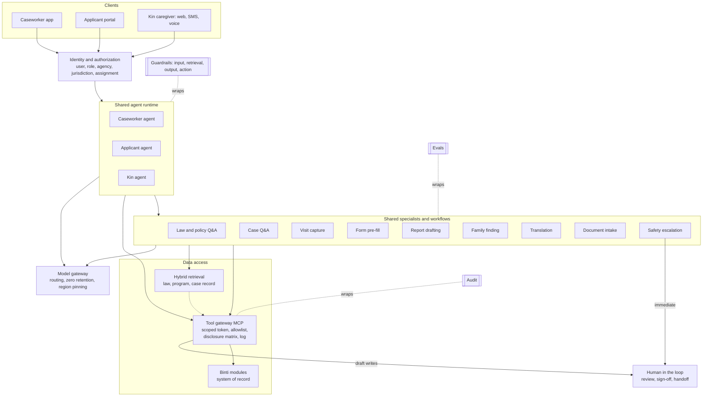

# Binti AI architecture

v1.1 · Nov 2026 · @Bharath · Target design taken from the persona canvas (`canvas/index.html`). Section 9 maps it to this repo. Binti's existing AI work is unknown, so validate with engineering before building.

## Decisions

| # | Decision | Why | Rejected, and why |
|---|---|---|---|
| D1 | **One runtime, three persona-scoped agents** (caseworker, applicant, kin) and **shared specialists** (law Q&A, case Q&A, visit capture, form pre-fill, report drafting, family finding, translation, document intake, safety escalation) | Permissions, tone and latency differ by who is asking, so those are split. Law, translation and safety logic must give one answer, so those are shared | **One agent:** the role check lives in the prompt, and a family's message sits next to tools that write to the case. **Three separate agents:** shared logic gets built three times and the answers drift |
| D2 | **Authorization in the tool gateway**, checked per call with the user's identity | A model can't leak a field it never received, and can't call a tool missing from its list | **Rules in the prompt:** they can be talked around |
| D3 | **Every write is a proposal** that a named person approves | Case records, court filings and messages to families carry legal and human weight | **Auto-write with undo:** the harm happens before anyone undoes it |
| D4 | **Workflows for fixed-step, high-stakes work** (visit capture, pre-fill, court report). **An agent loop for open questions** (chat) | Fixed steps can be tested, audited and replayed | **An agent for everything:** the path is non-deterministic on outputs that go to court |
| D5 | **Hybrid retrieval** (keyword plus vector), with jurisdiction and effective date as hard filters | Workers type citations ("42 U.S.C. 671(a)(29)"), which suits keyword search. Families type plain words ("can I take them now?"), which suits vector search. Procedure varies by state | **Vector only:** misses exact citations. **Ranking by jurisdiction:** it surfaces another state's rule |
| D6 | **The AI never decides** placement, custody, eligibility, approval or risk, and never scores families | These are the highest-harm and most bias-prone calls, and the law assigns them to people | **Predictive risk scoring:** it encodes historical bias and breaks the canvas principle of no scores tied to child outcomes |
| D7 | **Rules pick the case stage and next actions. The model only explains them** | Explainable, testable, and it never ranks children | **Priorities inferred by the model:** they can't be audited and drift silently |
| D8 | **Caseworker features first.** Family-facing features only after the safety harness and the law corpus exist | A worker can check every output. A grieving relative can't | **Family chat first:** the highest-risk audience with the weakest checks |

Revisit D1 when a fourth persona arrives (supervisor, court, provider), or if compliance requires separate deployments per persona.

## 1. Personas

| | Caseworker | Prospective parent | Kin caregiver |
|---|---|---|---|
| Sees | Assigned cases | Their own application | The placed child, allowed fields only |
| Can draft (needs approval) | Note, form, task, outreach, court report, referral, visit | Application field, upload, visit booking, reference requests (after the family confirms who) | Benefit application, message to the worker, callback, concern |
| Never | Other workers' cases, final sign-off | Other families, internal notes, approval decisions | Parents' records, reporter identity, placement or eligibility decisions |
| Tone | Professional, brief, sourced | Warm, encouraging, about grade 8 | Calm, plain, grade 6 to 8, Spanish when asked |
| Work pattern | Asynchronous drafting, then review | Evening, on a phone, form-heavy | Real time, often in a crisis |

Tone and emotional-state rules are in `AGENTS.md`.

## 2. Harness

Every persona runs through the same 14 components. Only the scope differs.

| Component | Job | Where personas differ |
|---|---|---|
| Identity and authorization | Carries user, role, agency, jurisdiction and assignment into every call | Data scope (section 1) |
| Context assembly | Builds the prompt from the persona profile, language and object snapshot | Tone and reading level |
| Retrieval: law and policy | Cited answers on statute, regulation, court rules and policy | Caseworker: section level. Families: plain language plus what to ask the worker |
| Retrieval: case record | Notes, transcripts, reports | Caseworker: full case. Others: their own slice |
| Tool gateway (MCP) | Authorizes, filters and logs every call | Allowlist per persona |
| Workflow engine | Fixed pipelines with model steps inside | Capture, pre-fill and report (caseworker). Intake and application (family) |
| Speech to text | Speaker-labeled transcripts, with offline capture | Caseworker only, and only with consent |
| Translation | Glossary-based machine translation | Outbound text needs a bilingual human check |
| Memory | Session memory plus memory scoped to one case or application | Stored facts never carry across cases. The caseworker's home chat is one saved thread that reads cases live, and saves facts only to the case they belong to |
| Guardrails | Input, retrieval, output and action checks | Kin and applicant also get safety-disclosure detection |
| Human in the loop | Review, sign-off, warm handoff | The worker signs. The family submits |
| Model gateway | Routing, zero-retention terms, region pinning, fallback | None |
| Audit | An immutable record of who asked, what was shown and what changed | None |
| Evals | Offline golden sets and online signals | One pass bar per persona and per specialist |

## 3. Retrieval

| Corpus | Contents | Users | Refresh |
|---|---|---|---|
| Law and policy | Federal floor (ASFA, ICWA, Title IV-E, Fostering Connections, FFPSA, CAPTA), state statute and regulations, court rules, ICPC, agency manual | All | On change, with effective dates kept |
| Program content | Licensing steps, training, FAQs, benefit guides, provider directory | All | Versioned by the agency |
| Case record | Notes, transcripts, plans, referrals, genogram | Caseworker. Others see their own slice | Live |

The law list is from general knowledge. Counsel confirms it per jurisdiction before anything is indexed.

**Pipeline:**
1. Filter by jurisdiction, date, audience and permission.
2. Rewrite the query using a persona glossary.
3. Search by BM25 and by vector, merged with reciprocal rank fusion.
4. Rerank with a cross-encoder.
5. Return the whole parent section, so exceptions aren't cut off.
6. Follow links from statute to regulation to policy.
7. Compose an answer with a citation per claim, or abstain and hand off.

**Rules:**
- Query, don't embed, anything a tool can return: dates, tasks and statuses.
- Explain, never advise on law.
- Run a golden question set per jurisdiction, written with counsel, on every corpus change.

## 4. Tool gateway

Each Binti module sits behind one gateway, exposed as MCP servers. For each call the gateway:
1. Exchanges the session for a scoped token and authorizes with the **user's** identity, never the agent's.
2. Checks the persona allowlist and validates inputs against a schema. User text is never put into a query unescaped.
3. Applies the **disclosure policy matrix**: one row per field (name, date of birth, medical, school, court dates, parent contact, reason for removal), one column per persona and agency setting. Data is removed before it reaches the model. The matrix is agency configuration, signed off by counsel, because the rules vary by jurisdiction.
4. Turns writes into idempotent proposals that return a diff.
5. Enforces rate limits and cost caps per user and per feature.
6. Logs the inputs, the fields returned and the policy decision.

## 5. Features

Phase 1 proves time saved for caseworkers and ships the safety harness. Phase 2 adds law retrieval and the family guides. Phase 3 adds the highest-stakes family surfaces.

**Caseworker**

| Feature | Problem | Mechanism | Phase |
|---|---|---|---|
| Day briefing | The day is assembled from spreadsheets and email | Workflow over tasks, calendar and case events, ranked by urgency. Shown as color-coded cards (urgent, soon, routine) that start a question in the caseload chat | 1 |
| Caseload assistant (Binti AI home) | Opening each child's page to ask a question is slow | The caseworker lands on a full-screen chat over their whole caseload. Each answer names the child and case it draws on. It reads any assigned case through the gateway, and saves memory only to one case | 1 |
| Case next action | Working out what a case needs costs time | Rules name the stage and the actions, each with a reason and source. The worker pins and reorders, and those priorities are saved per case | 1 |
| Case summary | Handoff packets are thin | Case retrieval with a source on every line | 1 |
| Case chat | Answers are spread across five screens | Agent loop over case tools | 1 |
| Visit capture and note | The keyboard competes with the family. Notes are typed twice | Speech to text with consent, then a draft note citing transcript times, then the worker signs | 1 |
| Form pre-fill | The same facts are re-entered on every form | Fields extracted with a source quote and a confidence level for each | 1 |
| Language check | Blaming words enter permanent records | Classifier plus a rewrite grounded in the transcript. The worker decides | 1 |
| Law and policy Q&A | Deadlines are buried in manuals | Hybrid retrieval with citations | 2 |
| Family finding and outreach translation | Kin searches are manual, and relatives speak other languages | Entity resolution, an automatic genogram, translated drafts with a human check | 2 |
| Court report assembly | Facts are gathered the night before | Workflow that collects cited facts. The worker writes the recommendation | 2 |
| Plan builder and referrals | Plans live in documents and referrals go out by email | Tasks from goals, provider matching, closed-loop status | 2 |
| Compliance watcher, closing pre-fill | Reporting data is fixed at the end | Rules plus a model flag gaps as the work happens | 3 |

The time-back figure comes from telemetry. No model generates it.

**Prospective parent**

| Feature | Problem | Mechanism | Phase |
|---|---|---|---|
| Guide Q&A | The process and timeline are unclear | Retrieval over program content, filtered by jurisdiction | 1 |
| Inquiry triage | Families inquire, then wait | Classify language, intent and urgency, route to a named worker, acknowledge | 1 |
| Application assistant | Repeated entry, blank-page answers | Pre-fill plus drafts written **only** from the family's own notes | 1 |
| Document intake, references, status explainer | Repeat requests and long waits | OCR with a completeness check, reminders, a timeframe shown with its uncertainty | 2 |
| Home study drafting | The report is written by hand | Reuses visit capture for the licensing worker | 2 |
| Placement call explainer | Little guidance at first placement | Plain summary of the child information the worker has approved | 3 |
| Drop-off analytics | Stalled applicants mean children wait longer | Aggregate funnel analysis, with no scoring of individuals | 3 |

**Kin caregiver**

| Feature | Problem | Mechanism | Phase |
|---|---|---|---|
| Safety disclosure detection | A risk can come up in any message | Checked on every message before the model sees it, with immediate escalation to a person. Ships with any chat | 1 |
| First-contact message | Contact comes late, as a shock, in the wrong language | A plain message in the relative's language, reviewed by the worker, with a named person to call | 1 |
| Decision guide | Options and requirements are unclear | Plain-language retrieval plus a handoff to the worker | 1 |
| Schedule and child details | Information arrives piecemeal | Tools filtered by the disclosure matrix | 1 |
| Benefits navigator, approval reuse | Money strain, approval checks starting from zero | Prefilled application drafts (the system decides eligibility), family-finding data carried into approval | 2 |
| Everyday care, strain triage | Scattered appointments, little support | Reminders. Distress signals route to a named contact, never AI counseling | 2 |
| Long-term path explainer | Guardianship versus adoption is unclear | Retrieval plus next steps and who to ask | 3 |

## 6. Request flow

Each request passes through identity, then the persona agent, then shared specialists, then the gateway. Guardrails, audit and evals wrap the whole path.

## 7. Safety and evals

**Guardrails.** There are four checkpoints, so no single check carries the safety case.

| Point | Checks |
|---|---|
| Input | Prompt injection, PII handling, language detection, safety disclosure and crisis detection (kin and applicant) |
| Retrieval | Permission, jurisdiction and effective-date filters |
| Output | Citation required. No legal advice and no placement, custody, eligibility or risk decisions. Fault-language check, reading level |
| Action | Draft only, human approval, rate limits, idempotency |

**Who approves**

| AI output | Approver |
|---|---|
| Visit note, form, court report | The caseworker signs |
| Outreach and its translation | The caseworker, plus a bilingual check |
| Application text | The family submits |
| Benefit application | The caregiver submits, and the eligibility module decides |
| Safety disclosure | A named person, immediately |

**Evals.** Set the pass bars before launch, and block a release when one is missed. The golden set is in `evals/`.

| Eval | Feature | Source of truth |
|---|---|---|
| Draft accuracy, edit distance | Notes, pre-fill, reports | The note the worker signed |
| Fault-language catch rate and false alarms | Language check | Set labeled by supervisors |
| Citation accuracy, abstain rate | Law Q&A | Golden set per jurisdiction, written with counsel |
| Translation quality | Outreach | Bilingual reviewers |
| Safety recall | Family chat | Red-team scripts |
| Leakage (cross-case, disclosure matrix) | Gateway | Red-team scripts. Target: zero |
| Time saved | Caseworker features | Telemetry against a baseline taken before launch |

## 8. Non-goals, open questions, build order

**Non-goals:**
- No predictive risk scoring.
- No AI decision on placement, custody, eligibility or approval.
- No recording without consent.
- No AI text filed with a court without the worker's sign-off.
- No training on case data.

**Open questions:**
1. Are caregiver chats part of the discoverable case record? The answer sets retention and what the chat may say.
2. Who owns the disclosure matrix in each agency, and who in counsel signs it off?
3. What data residency and model-vendor terms apply per state, and later in Canada and Australia?
4. Who curates the law corpus, and how often?
5. Which confidentiality regimes apply (child welfare, education, health)?
6. Does Binti's existing AI work already fix the model provider or the chat surface?

| Phase | Build | Exit test |
|---|---|---|
| 0 | Gateway, authorization, audit, eval harness, safety detection | A red-team run finds no cross-case or cross-family leak |
| 1 | Caseworker: briefing, caseload assistant, next action, summary, chat, visit capture through note and pre-fill, language check. Family: guide Q&A, triage, application assistant, schedule lookup | Time from visit to signed note falls, and draft accuracy meets its bar |
| 2 | Law retrieval, family finding and translation, court report, document intake, benefits | Citation accuracy meets its bar in each launch jurisdiction |
| 3 | Placement and long-term explainers, compliance watcher, analytics | Counsel and supervisors sign off |

## 9. This repo

The prototype uses fictional data only.

| Design | Code |
|---|---|
| Runtime and personas (D1) | `binti/agent.py` loads the core rules and one persona profile from `AGENTS.md` |
| Specialists | 15 Agent Skills in `skills/<name>/SKILL.md`. The agent sees each name and description, and calls `load_skill` for the body |
| Workflows (D4) | `binti/workflows.py`: briefing, visit note, pre-fill, language check, first contact, triage, application help |
| Gateway (D2, D3) | `binti/gateway.py`: one schema registry, persona allowlist, per-user scope, disclosure matrix, audit on every call, idempotent proposals. Plain function calls stand in for MCP |
| Stage and next action (D7) | `binti/stages.py` |
| Retrieval (D5) | `program_search`: BM25-style keyword search, with the audience filter applied first. The vector half and the law corpus come in Phase 2 |
| Memory | `chat_messages` (keyed by case, application, or the caseworker's caseload thread) and `case_memory` (always keyed by one case or application) |
| Guardrails | `binti/guardrails.py`. Safety detection runs before any model call |
| Model gateway | `binti/llm.py`: DeepSeek through `DEEPSEEK_API_KEY`, with a scripted fallback on the same gateway. The vendor choice is still subject to open questions 3 and 6 |
| Audit | The `audit_log` table, shown in the case page's Audit log tab |
| Evals | `tests/` (unit tests), `evals/golden.json` with `evals/run_evals.py` (golden set), and draft ratings in the AI quality drawer |
| Speech to text | Not built. Transcripts are seeded, with consent and speaker labels |
