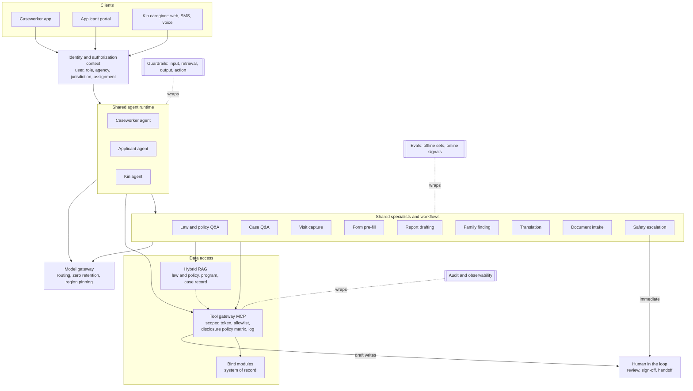

# Binti AI architecture: agents, harness and features by persona

Nov 4, 2026 · @Bharath · Full repo copy of the architecture doc. This is the working reference for Claude Code. Keep it in sync with the source doc.

**Decision:** one Binti AI platform, three persona-scoped agents, and a shared set of specialist sub-agents and workflows. Split by who is asking (permissions, trust, tone). Share by what needs doing (law lookup, translation, drafting, safety).

- **Agents:** Caseworker, Applicant (prospective parent) and Kin. Each is a configuration of one runtime (prompt, tool allowlist, data scope, reading level), not a separate codebase.
- **Shared specialists:** Law and policy Q&A, Case Q&A, Visit capture, Form pre-fill, Report drafting, Family finding, Translation, Document intake, Safety escalation.
- **RAG:** hybrid (keyword + vector + metadata filters + reranker) over three corpora: law, agency policy and program content, and the case record. Law retrieval is filtered by jurisdiction and effective date.
- **Tools:** one tool gateway over Binti modules. Reads are scoped to the signed-in user. Writes are drafts that a human approves.
- **Safety:** authorization is enforced in the data layer, not the prompt. AI never decides placement, eligibility or risk. Every feature has an audit trail and an eval.

> This is a target design from the persona canvas (`canvas/index.html`). Binti's current AI implementation is not known, so check it with engineering.

---

## 1. One agent, three agents, or both?

Use persona-scoped agents on one shared runtime, with shared specialist sub-agents underneath. The two extremes each fail on a different axis.

| Option | What it is | Verdict | Main reason |
|---|---|---|---|
| One big agent for everyone | One prompt and one tool set, with the user's role checked inside the prompt | Reject | Permissions live in text the model can be talked out of. A family member's message sits in the same context as tools that write to the case |
| Three independent agents | Separate prompts, tools, retrieval and codebases per persona | Reject | The law answer, translation and safety logic get built three times and drift. The same question gets different answers |
| **Persona-scoped agents + shared specialists** | One runtime. Persona profile sets prompt, tool allowlist, data scope and reading level. Specialists are called by any persona | **Choose** | Isolation where it matters, reuse where it pays |

**Why this holds up**

- **Permissions differ by persona and must be enforced outside the model.** The caseworker sees the case. The kin caregiver sees only what the agency allows about a child in their care. The applicant sees only their own application. An agent whose tool list never contains a tool cannot be talked into calling it.
- **The jobs differ.** Caseworker work is mostly asynchronous drafting that the worker reviews. Family-facing work is real time, emotional, multilingual and written at a plain reading level. Latency, tone and refusal behavior are not the same.
- **Shared specialists keep answers consistent.** A caseworker and a caregiver asking about kinship placement should get the same cited answer, framed differently. One Law and policy specialist does that.
- **Smaller tool sets pick the right tool more often.** Each persona agent sees roughly 8 to 15 tools instead of every Binti tool (a rule of thumb to test, not a measured figure).
- **Smaller blast radius.** Untrusted text from a family member (a message, an uploaded document) never reaches tools that write to the case or read other families.
- **Cleaner evals.** Each persona agent and each specialist gets its own test set and its own pass bar.
- **Continuity.** A kin caregiver can become a licensed foster parent. Same person, same identity, different role profile.

**Agent or workflow?** Fixed-step, high-stakes work runs as a deterministic pipeline with model calls inside it: visit capture, form pre-fill, court report assembly. Open-ended questions run as an agent loop with tools: the chat features. If you can write the steps down, it is a workflow.

**Revisit** when a fourth persona is added (supervisor, court, provider) or when compliance asks for separate deployments per persona. The same pattern extends to both.

---

## 2. Harness components

Fourteen components make up the harness. Every persona runs through the same ones. What changes is the scope each persona is given.

| Component | What it does | Caseworker | Prospective parent | Kin caregiver |
|---|---|---|---|---|
| Identity and authorization context | Carries user, role, agency, jurisdiction and case assignment into every call | Assigned cases | Own application | Placed child, allowed fields only |
| Context assembly | Builds the prompt from persona profile, jurisdiction, language, reading level and a case snapshot | Professional | Plain, encouraging | Plain, calm, 6th to 8th grade |
| Hybrid RAG: law and policy | Cited answers on statute, regulation, court rules and agency policy | Deep, section level | Program level | Plain-language, with what to ask the worker |
| Hybrid RAG: case record | Finds what was said or done in notes, reports and transcripts | Full case | Own application only | Allowed fields only |
| Tool gateway (MCP) | One place where every tool call is authorized, filtered and logged | Read, plus draft writes | Read, plus draft writes on own application | Mostly read, plus requests |
| Workflow engine | Runs fixed-step pipelines with model calls inside | Capture, report, pre-fill | Document intake, application | Benefit application start |
| Speech to text | Transcribes with speaker labels, works offline in the field | Yes, consent-gated | No | Later, for voice input |
| Translation | Machine translation with glossary, then human review for outbound | Outreach | Yes | Yes |
| Memory | Short-term session memory and case-scoped memory. Nothing carries across cases | Case | Application | Household |
| Guardrails | Input, retrieval, output and action checks | All four | All four | All four, plus safety disclosure |
| Human in the loop | Review, sign-off and warm handoff | Worker signs | Worker reviews | Worker takes over |
| Model gateway | Model routing by task, zero-retention terms, region pinning, fallback | Yes | Yes | Yes |
| Audit and observability | Immutable log of who asked, what data was shown, what was drafted, what was changed | Yes | Yes | Yes |
| Evals | Offline test sets and online quality signals | Yes | Yes | Yes |

---

## 3. Hybrid RAG

Use hybrid retrieval, because the questions come in two shapes. A caseworker types a citation or a term of art ("ICWA active efforts", "42 U.S.C. 671(a)(29)"), which keyword search handles best. A kin caregiver asks in plain words ("can I take them before I'm approved?"), which vector search handles best. Federal law sets a floor. Most procedure lives in state statute, state regulation, court rules and agency policy, so jurisdiction is a hard filter, not a ranking signal.

| Corpus | Content | Used by | Refresh |
|---|---|---|---|
| Law and policy | Federal: ASFA, ICWA, Title IV-E, Fostering Connections (relative notice), FFPSA, CAPTA. State statutes and regulations. Court rules. Interstate placement (ICPC). Agency policy manual | All three | On any change, with effective dates kept |
| Program and provider content | Licensing steps, training calendars, FAQs, benefit guides, provider directory | Parent, Kin, Caseworker | Agency-owned, versioned |
| Case record | Notes, reports, transcripts, plans, referral log, genogram | Caseworker. Parent and Kin see their own slice only | Live |

The law list above is from general knowledge. Agency counsel should confirm it per jurisdiction before it is indexed.

**Pipeline**

1. **Filter first:** jurisdiction, effective date, audience and the user's permissions, before any scoring.
2. **Rewrite the query for the persona:** expand plain words to legal terms with a glossary ("take the kids" to "relative placement, emergency, provisional approval").
3. **Retrieve both ways:** keyword (BM25) and vector search, merged by reciprocal rank fusion.
4. **Rerank** the top candidates with a cross-encoder.
5. **Return parent context:** retrieve at subsection level, show the full section so the answer is not stripped of its exceptions.
6. **Follow links:** statute to regulation to agency policy, kept as metadata links first. A graph store comes later if needed.
7. **Compose with a rule:** every claim carries a citation. If nothing relevant is found, say so and hand off to a person.

**Answer shape by persona**

| Persona | Answer includes |
|---|---|
| Caseworker | Citation, the procedure, the deadline, and the agency policy that applies |
| Prospective parent | The step in plain words, what it asks of the family, and who to call |
| Kin caregiver | A plain-language answer at 6th to 8th grade, what to ask the worker, and a link to the source |

**Rules**

- Do not embed what you can query. Appointments, task lists and statuses come from tools, not from vector search.
- The assistant explains. It does not give legal advice, and it says so. Legal questions about a specific family go to the worker or a family law advisor.
- Build a golden question set per jurisdiction with agency counsel and run it on every corpus change.

---

## 4. Tool calling

Tools sit behind one gateway that wraps each Binti module as an MCP server. The gateway exchanges the user's session for a scoped token, checks the call against the persona's allowlist, filters the returned fields by policy, and logs it. Reads return only what the signed-in user may see. Writes never change the record directly. They create a proposal that a human approves.

| Persona | Read tools | Draft or request tools (approval required) | Never available |
|---|---|---|---|
| Caseworker | Case summary, case notes search, tasks, court dates, genogram, referral status, provider directory, external record search | Draft note, pre-fill form, propose task, draft outreach, draft court report, send referral, schedule visit | Other workers' cases, anything outside assignment, final sign-off |
| Prospective parent | Own application status, checklist, training sessions, available visit slots | Save application field, upload document, book visit slot, request references (after the family confirms who) | Other families' data, internal worker notes, approval decisions |
| Kin caregiver | Placed child's schedule (appointments, visits, court dates), allowed child details, worker contact, benefit options | Start a benefit application draft, message worker, request callback, report a concern | Parents' records, reporter identity, placement changes, eligibility decisions |

**Child details for caregivers.** A caregiver asking for details about a child is the hardest case. Handle it with a **disclosure policy matrix**: one row per field (name, date of birth, medical, school, court dates, parent contact, reason for removal), one column per persona and per agency setting. The gateway applies it before data reaches the model, so the model cannot reveal what it never received. Which fields a caregiver may see varies by jurisdiction and agency, so the matrix is configuration owned by the agency, reviewed by counsel.

**Gateway rules**

1. Authorization is checked per call with the user's identity, never with the agent's own.
2. Tool inputs are validated against a schema. Free text from a user is never placed into a query unescaped.
3. Write tools are idempotent and return a diff for review.
4. Rate limits and cost caps per user and per feature.
5. Every call is logged with its inputs, the fields returned and the policy decision.

---

## 5. AI features by persona, and why

Phase 1 proves time saved for caseworkers and ships the safety harness. Phase 2 adds law retrieval and the family-facing guides. Phase 3 adds the highest-stakes family surfaces. Each feature maps to a stage in the persona journeys.

### Caseworker

| Feature | Why it is needed | How it works | Phase |
|---|---|---|---|
| Start-of-day briefing | The day is built from spreadsheets, notes and email | Workflow over tasks, calendar and case events, ranked by urgency | 1 |
| Case next action (context-aware panel) | Workers lose time working out what a case needs next | Opening Binti AI on a case reads it, names the journey stage with its evidence, and lists next actions by urgency, each with a reason and a source. Rules decide; the model explains. The worker pins and reorders, and those priorities are saved per case | 1 |
| Case summary on handoff | New cases arrive as thin or scattered packets | Case RAG, with a source on every line | 1 |
| Chat with Binti AI | Workers need instant case answers without opening five screens | Agent with case tools and case RAG | 1 |
| Visit transcription | The keyboard competes with the family for attention | Consent-gated speech to text with speaker labels. Offline capture, sync later | 1 |
| Visit note drafting | Notes are written in the field, then again in the system | Workflow from transcript to draft note for review and signature | 1 |
| Form pre-fill with provenance | The same facts are re-entered across forms | Extract fields from the transcript. Show the source quote and a confidence level per field | 1 |
| Language and bias check | Fault-assigning wording ends up in permanent records | Classifier plus a suggested rewrite grounded in the transcript. Worker decides | 1 |
| Law and policy Q&A | Deadlines and procedures sit in long manuals | Hybrid RAG with citations | 2 |
| Family finding assistant | Kin searches run across separate tools and trees are drawn by hand | Entity resolution to rank candidates, auto-built genogram, draft outreach | 2 |
| Outreach translation | Relatives often speak another language | Machine translation with glossary, then a human check before sending | 2 |
| Court report assembly | Facts are pulled from many places the night before | Workflow that gathers cited facts. The recommendation is written by the worker | 2 |
| Plan builder and referral matching | Plans live in documents and referrals go out by email | Suggested tasks from goals, provider match, closed-loop status | 2 |
| Compliance data watcher | Reporting data is corrected at the end | Rules plus a model flag missing or contradictory required fields as the work happens | 3 |
| Closing checklist pre-fill | Closing data is re-entered | Workflow from the case record | 3 |

The weekly time-back view is computed from product telemetry, not generated by a model.

### Prospective parent

| Feature | Why it is needed | How it works | Phase |
|---|---|---|---|
| Plain-language guide and Q&A | The process is hard to understand and the timeline is unclear | Hybrid RAG over program content and licensing rules, filtered by jurisdiction | 1 |
| Inquiry triage and routing | Families inquire, then wait | Classify language, intent and urgency. Route to a named worker. Send an acknowledgement | 1 |
| Application assistant | Paper forms and repeated entry | Pre-fill from the inquiry. "Help me write this" drafts from the family's own notes. They edit and submit | 1 |
| Document intake | Documents are requested more than once | OCR and extraction on medical statements, IDs and certificates, then a completeness check | 2 |
| Checklist and reference automation | Families are unsure what is outstanding | Reminders and reference requests sent after the family confirms who | 2 |
| Home study drafting (worker side) | The home study report is written by hand after the visit | Reuses visit capture to draft the report for the licensing worker | 2 |
| Status and timeline explainer | Long, unclear wait | Status from the system of record. Expected timeframe from aggregated history, shown with its uncertainty | 2 |
| Voice, SMS and translation | Mobile first, and in the family's own language | Same agent over more channels | 2 |
| Placement call explainer | Little guidance on a first placement | Plain-language summary of the placement worker's approved child information. Names shared after the family says yes | 3 |
| Drop-off analytics for the agency | Every stalled applicant is a child waiting longer | Aggregate funnel analysis. No individual scoring | 3 |

### Kin caregiver

| Feature | Why it is needed | How it works | Phase |
|---|---|---|---|
| Safety disclosure detection | A caregiver may mention a risk to a child at any point | Classifier on every message. Immediate human escalation. Ships with any chat | 1 |
| First-contact message in plain words | Contact comes late, in a shock, often in the wrong language | Worker-reviewed message in the relative's language, with a person to call | 1 |
| Decision guide and Q&A | Requirements and options are unclear | Hybrid RAG on law and policy with plain-language answers and a worker handoff | 1 |
| Child details and schedule lookup | Information arrives by phone or email | Tool calls through the disclosure policy matrix | 1 |
| Benefits navigator | Fewer supports than licensed parents, and financial strain | Read eligibility options, start a prefilled application draft. The system decides eligibility, not the AI | 2 |
| Approval checklist with reuse | Checks start from zero | Carry family finding data into the approval steps | 2 |
| Everyday care assistant | School, health, visits and court arrive in separate places | Reminders and questions answered from the child's schedule | 2 |
| Strain and support triage | Caregivers carry stress with little support | Detect distress, offer the named contact and agency resources. It does not provide counseling | 2 |
| Long-term path explainer | The path to guardianship or adoption is unclear | Hybrid RAG with next steps and who to talk to | 3 |

---

## 6. Overall architecture

A request runs top to bottom. The client sends it, identity attaches the user's scope, the persona agent handles it and calls shared specialists, and every data access goes through the tool gateway. Guardrails, audit and evals wrap the whole path.

---

## 7. Guardrails, human in the loop and evals

Guardrails sit at four points in every request, so no single check carries the safety case.

| Point | Checks | Persona focus |
|---|---|---|
| Input | Prompt injection in messages and uploads, PII handling, language detection, safety disclosure and crisis detection | Kin, Parent |
| Retrieval | Permission filter, jurisdiction filter, effective-date filter | All |
| Output | Citation required, no legal advice wording, no placement, custody, eligibility or risk decisions, fault-language check, reading level | All |
| Action | Draft only, human approval, rate limits, idempotency | Caseworker, Parent |

**Who approves what**

| AI output | Approved by |
|---|---|
| Visit note, form fields, court report | The caseworker, who signs |
| Outreach to a relative, and its translation | The caseworker, with a bilingual check for translations |
| Application text drafted for a family | The family, who submits |
| First-contact message to a kin caregiver | The caseworker |
| Benefit application started for a caregiver | The caregiver submits. The eligibility module decides |
| Any safety disclosure | A named human, immediately |

**Evals**

| Eval | What it measures | Feature | Source of truth |
|---|---|---|---|
| Draft accuracy | Share of facts in the draft that match the transcript | Visit note, pre-fill | Worker-approved final note |
| Edit distance | How much the worker changed | Notes, reports | Draft against final |
| Fault-language catch rate | Biased or blaming phrases flagged, and false alarms | Language check | Labeled set reviewed by supervisors |
| Citation accuracy | Answers supported by the cited text | Law and policy Q&A | Golden set per jurisdiction, written with counsel |
| Abstain rate | Correctly declines when the corpus has no answer | Law and policy Q&A | Out-of-scope question set |
| Translation quality | Meaning preserved, tone appropriate | Outreach, first contact | Bilingual reviewers |
| Safety recall | Disclosures caught and escalated | Kin, Parent chat | Red-team scripts and reviewed samples |
| Time saved | Minutes from visit to signed note, report prep hours | Caseworker features | Product telemetry against a pre-launch baseline |

The rating buttons in the prototype are the first online signal. Fix pass bars before launch, and block release when a bar is missed.

---

## 8. Non-goals, open questions and build order

**Non-goals**

- No predictive risk scoring of families or children. It is the feature most likely to encode bias, and the canvas principles rule out scores tied to child outcomes.
- No AI decision on placement, custody, eligibility or approval.
- No recording without consent, and no AI text filed with a court without the worker's sign-off.
- No training on case data.

**Open questions**

1. Are caregiver chats part of the case record, and so discoverable? This decides retention and what the chat may say.
2. Who owns the disclosure policy matrix per agency, and who in counsel signs it off?
3. What data residency and model vendor terms apply per state, and for Canada and Australia later?
4. Who curates and validates the law corpus, and how often?
5. Which confidentiality rules apply to the data the agents touch (state child welfare confidentiality, education and health records)? Counsel to confirm.
6. Does Binti's existing AI work already fix choices in this design, such as the model provider or the chat surface?

**Build order**

| Phase | Build | Exit test |
|---|---|---|
| 0 | Gateway, authorization context, audit log, eval harness, safety disclosure detection | A red-team run finds no cross-case or cross-family leak |
| 1 | Caseworker: briefing, case next action, case summary, case chat, visit capture to note to pre-fill, language check. Family: guide Q&A, inquiry triage, application assistant, child schedule lookup | Time from visit to signed note falls against the pre-launch baseline, and draft accuracy meets the bar |
| 2 | Law and policy RAG, family finding and translation, court report assembly, document intake, benefits navigator | Citation accuracy meets the bar on each launch jurisdiction |
| 3 | Placement call explainer, long-term path explainer, compliance watcher, agency analytics | Counsel and supervisors sign off the high-stakes surfaces |

Caseworker features go first because their value is measurable in minutes and the worker reviews every output. Family-facing features need the safety harness and the law corpus first, since the person asking cannot check the answer.

---

## 9. Prototype implementation (this repo)

This section maps the design to the code. The prototype uses fictional data only.

| Design element | Prototype |
|---|---|
| Persona-scoped agents on one runtime | `binti/agent.py` loads the core rules and one persona profile from `AGENTS.md` |
| Shared specialists | 14 Agent Skills in `skills/<name>/SKILL.md`. The agent sees names and descriptions and calls `load_skill` for the body |
| Workflow vs agent loop | Workflows: `binti/workflows.py` (briefing, visit note, form pre-fill, language check, first contact, inquiry triage, application help). Agent loop: chat |
| Identity and authorization context | Persona switcher, resolved in `gateway.Identity`: assigned cases, the kin caregiver's child, the family's own application |
| Tool gateway (MCP) | `binti/gateway.py`: one registry with JSON schemas, persona allowlist, per-call scope check with the user's identity, disclosure matrix applied before data reaches the model, audit log on every call. Plain function calls stand in for MCP servers |
| Writes as proposals | Every draft tool creates an idempotent proposal. People approve or reject in the UI (`gateway.decide`) |
| Disclosure policy matrix | `disclosure` table plus an agency setting (`kin_medical`), seeded in `binti/seed.py` |
| Hybrid RAG | Keyword (BM25-style) retrieval over program content with an audience filter applied first (`program_search`). The vector half and the law corpus are Phase 2 |
| Memory | `chat_messages` and `case_memory`, keyed by object (case or application). Nothing carries across cases |
| Guardrails | `binti/guardrails.py`: safety disclosure (before any model call), prompt injection, emotional cues, decision and legal-advice output checks, fault-language check, reading level |
| Model gateway | `binti/llm.py`: DeepSeek (OpenAI-compatible tool calling) through `DEEPSEEK_API_KEY`. With no key, a scripted fallback runs on the same gateway and rules |
| Audit and observability | `audit_log` table, shown in the case page's Audit log tab |
| Evals | Unit tests for permissions, disclosure, stages, guardrails and the live tool loop (against a fake server). Draft ratings feed the AI quality drawer. The offline eval harness is next |
| Speech to text | Not built. Visit transcripts are seeded with consent and speaker labels |

**Additions to the design from the prototype.** The case next-action feature (section 5) is new. It covers the "current object" panel: when a caseworker opens Binti AI on a case, it gets that case's context, names the stage and suggests what to do next. The stage and action rules live in `binti/stages.py` so they can be explained and tested. Model choice is now a working assumption (DeepSeek) and stays subject to open questions 3 and 6.
