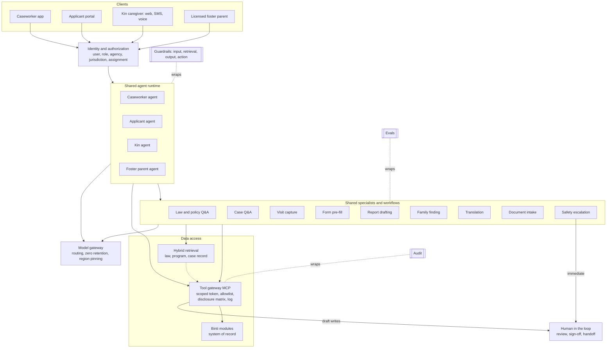

# Binti AI architecture

v1.2 · Nov 2026 · @Bharath · Target design taken from the persona canvas (`canvas/index.html`), revised against public evidence (section 10). Section 9 maps it to this repo. Binti's existing AI work is unknown, so validate with engineering before building.

## Decisions

| # | Decision | Why | Rejected, and why |
|---|---|---|---|
| D1 | **One runtime, persona-scoped agents** (caseworker, applicant, kin, licensed foster parent) and **shared specialists** (law Q&A, case Q&A, visit capture, form pre-fill, report drafting, family finding, translation, document intake, safety escalation) | Permissions, tone and latency differ by who is asking, so those are split. Law, translation and safety logic must give one answer, so those are shared | **One agent:** the role check lives in the prompt, and a family's message sits next to tools that write to the case. **Three separate agents:** shared logic gets built three times and the answers drift |
| D2 | **Authorization in the tool gateway**, checked per call with the user's identity | A model can't leak a field it never received, and can't call a tool missing from its list | **Rules in the prompt:** they can be talked around |
| D3 | **Every write is a proposal** that a named person approves | Case records, court filings and messages to families carry legal and human weight | **Auto-write with undo:** the harm happens before anyone undoes it |
| D4 | **Workflows for fixed-step, high-stakes work** (visit capture, pre-fill, court report). **An agent loop for open questions** (chat) | Fixed steps can be tested, audited and replayed | **An agent for everything:** the path is non-deterministic on outputs that go to court |
| D5 | **Hybrid retrieval** (keyword plus vector), with jurisdiction and effective date as hard filters | Workers type citations ("42 U.S.C. 671(a)(29)"), which suits keyword search. Families type plain words ("can I take them now?"), which suits vector search. Procedure varies by state | **Vector only:** misses exact citations. **Ranking by jurisdiction:** it surfaces another state's rule |
| D6 | **The AI never decides** placement, custody, eligibility, approval or risk, and never scores families | These are the highest-harm and most bias-prone calls, and the law assigns them to people | **Predictive risk scoring:** it encodes historical bias and breaks the canvas principle of no scores tied to child outcomes |
| D7 | **Rules pick the case stage and next actions. The model only explains them** | Explainable, testable, and it never ranks children | **Priorities inferred by the model:** they can't be audited and drift silently |
| D8 | **Caseworker features first, plus the family features that only show records.** Family features that interpret law or rules wait for the safety harness and the law corpus | A worker can check every output; a grieving relative can't. But status, contacts, payment dates and care needs come straight from the record, and their absence drives families away (section 10) | **All family features later:** leaves the most-reported pains (silence, unexplained waits, unpaid kin) untouched for two phases |
| D9 | **Relief before reward for caseworkers.** Measure documentation hours and after-hours work first; recognition is second and never a score | The evidence is about overload: caseloads up to four times the recommended level, under 35% of time with families | **Reward-first framing:** treats burnout as a motivation problem rather than a workload problem |

The licensed foster parent was added as a fourth profile on the same runtime, as D1 anticipated. Revisit D1 for supervisors, courts and providers, or if compliance requires separate deployments per persona.

## 1. Personas

| | Caseworker | Prospective parent | Kin caregiver | Licensed foster parent |
|---|---|---|---|---|
| Sees | Assigned cases | Their own application, who holds each item, their messages | The placed child's allowed fields and care needs, approval steps, supports, who to call | The placed child's allowed fields and care needs, payments, adoption steps, who to call |
| Can draft or request | Note, form, task, outreach, court report, referral, visit | Application field, upload, visit booking, reference requests, message to worker | Benefit application, message to worker, callback, concern | Message to worker, callback, concern |
| Never | Other workers' cases, final sign-off | Other families, internal notes, approval decisions | Parents' records, reason for removal, reporter identity, placement or eligibility decisions | Parents' records, reason for removal, reporter identity, placement or adoption decisions |
| Tone | Professional, brief, sourced. Relief first | Warm, encouraging, about grade 8 | Calm, plain, grade 6 to 8, Spanish when asked | Practical and steady, about grade 8 |
| Work pattern | Overloaded; asynchronous drafting, then review | Evening, on a phone, form-heavy | Real time, often in a crisis; SMS and phone first | Daily care, appointments, a long wait for adoption |

Tone and emotional-state rules are in `AGENTS.md`.

## 2. Harness

Every persona runs through the same 14 components. Only the scope differs.

| Component | Job | Where personas differ |
|---|---|---|
| Identity and authorization | Carries user, role, agency, jurisdiction and assignment into every call | Data scope (section 1) |
| Context assembly | Builds the prompt from the persona profile, language and object snapshot | Tone and reading level |
| Retrieval: law and policy | Cited answers on statute, regulation, court rules and policy | Caseworker: section level. Families: plain language plus what to ask the worker |
| Retrieval: case record | Notes, transcripts, reports | Caseworker: full case. Others: their own slice |
| Tool gateway (MCP) | Authorizes, filters and logs every call | Allowlist per persona |
| Workflow engine | Fixed pipelines with model steps inside | Capture, pre-fill and report (caseworker). Intake and application (family) |
| Speech to text | Speaker-labeled transcripts, with offline capture | Caseworker only, and only with consent |
| Translation | Glossary-based machine translation | Outbound text needs a bilingual human check |
| Memory | Session memory plus memory scoped to one case or application | Stored facts never carry across cases. The caseworker's home chat is one saved thread that reads cases live, and saves facts only to the case they belong to |
| Guardrails | Input, retrieval, output and action checks | Families (kin, applicant, foster parent) also get safety-disclosure detection. Conditional wording ("after you are approved") is an explanation, not a decision |
| Human in the loop | Review, sign-off, warm handoff | The worker signs. The family submits |
| Model gateway | Routing, zero-retention terms, region pinning, fallback | None |
| Audit | An immutable record of who asked, what was shown and what changed | None |
| Evals | Offline golden sets and online signals | One pass bar per persona and per specialist |

## 3. Retrieval

| Corpus | Contents | Users | Refresh |
|---|---|---|---|
| Law and policy | Federal floor (ASFA, ICWA, Title IV-E, Fostering Connections, FFPSA, CAPTA), state statute and regulations, court rules, ICPC, agency manual | All | On change, with effective dates kept |
| Program content | Licensing steps, training, FAQs, benefit guides, provider directory | All | Versioned by the agency |
| Case record | Notes, transcripts, plans, referrals, genogram | Caseworker. Others see their own slice | Live |

The law list is from general knowledge. Counsel confirms it per jurisdiction before anything is indexed.

**Pipeline:**
1. Filter by jurisdiction, date, audience and permission.
2. Rewrite the query using a persona glossary.
3. Search by BM25 and by vector, merged with reciprocal rank fusion.
4. Rerank with a cross-encoder.
5. Return the whole parent section, so exceptions aren't cut off.
6. Follow links from statute to regulation to policy.
7. Compose an answer with a citation per claim, or abstain and hand off.

**Rules:**
- Query, don't embed, anything a tool can return: dates, tasks and statuses.
- Explain, never advise on law.
- Run a golden question set per jurisdiction, written with counsel, on every corpus change.

## 4. Tool gateway

Each Binti module sits behind one gateway, exposed as MCP servers. For each call the gateway:
1. Exchanges the session for a scoped token and authorizes with the **user's** identity, never the agent's.
2. Checks the persona allowlist and validates inputs against a schema. User text is never put into a query unescaped.
3. Applies the **disclosure policy matrix**: one row per field (name, date of birth, medical, school, court dates, parent contact, reason for removal, **care needs**), one column per persona and agency setting. Care needs (routines, health, school, what helps) are a separate field from the reason for removal, so caregivers can learn what the child needs without being told why the child came into care. Care-needs sharing is on by default in the prototype and needs counsel's sign-off. Data is removed before it reaches the model. The matrix is agency configuration, signed off by counsel, because the rules vary by jurisdiction.
4. Turns writes into idempotent proposals that return a diff.
5. Enforces rate limits and cost caps per user and per feature.
6. Logs the inputs, the fields returned and the policy decision.
7. Gives every family message to a worker a **reply deadline** (2 business days in the prototype). An unanswered message goes to the worker's supervisor automatically, and the family sees that it did.

## 5. Features

Phase 1 gives caseworkers time back, ships the safety harness, and closes the family gaps that only need records: who holds what, who to call, reply deadlines, payment dates and care needs. Phase 2 adds law retrieval and applications on the family's behalf. Phase 3 adds the highest-stakes surfaces. Changes from the evidence review are marked **(v1.2)**.

**Caseworker**

| Feature | Problem | Mechanism | Phase |
|---|---|---|---|
| Workload view and recognition **(v1.2)** | Caseloads far above the recommended level; turnover follows workload and poor support | Cases against the recommended level, due this week, overdue, drafts to sign, court within 14 days and minutes back, all from data. Supervisor recognition of named work. No scores | 1 |
| Day briefing | The day is assembled from spreadsheets and email | Workflow over tasks, calendar and case events, ranked by urgency. Shown as color-coded cards (urgent, soon, routine) that start a question in the caseload chat | 1 |
| Caseload assistant (Binti AI home) | Opening each child's page to ask a question is slow | The caseworker lands on a full-screen chat over their whole caseload. Each answer names the child and case it draws on. It reads any assigned case through the gateway, and saves memory only to one case | 1 |
| Case next action | Working out what a case needs costs time | Rules name the stage and the actions, each with a reason and source. The worker pins and reorders, and those priorities are saved per case | 1 |
| Case summary | Handoff packets are thin | Case retrieval with a source on every line | 1 |
| Case chat | Answers are spread across five screens | Agent loop over case tools | 1 |
| Visit capture and note | The keyboard competes with the family. Notes are typed twice | Speech to text with consent, then a draft note citing transcript times, then the worker signs | 1 |
| Form pre-fill | The same facts are re-entered on every form | Fields extracted with a source quote and a confidence level for each | 1 |
| Language check | Blaming words enter permanent records | Classifier plus a rewrite grounded in the transcript. The worker decides | 1 |
| Court report assembly **(v1.2: moved from Phase 2)** | Facts are gathered the night before; court paperwork adds to burnout | Workflow that collects cited facts in fixed sections. Section 7, the recommendation, is always left for the worker | 1 |
| Law and policy Q&A | Deadlines are buried in manuals | Hybrid retrieval with citations | 2 |
| Family finding and outreach translation | Kin searches are manual, and relatives speak other languages | Entity resolution, an automatic genogram, translated drafts with a human check | 2 |

| Plan builder and referrals | Plans live in documents and referrals go out by email | Tasks from goals, provider matching, closed-loop status | 2 |
| Compliance watcher, closing pre-fill | Reporting data is fixed at the end | Rules plus a model flag gaps as the work happens | 3 |

The time-back figure comes from telemetry. No model generates it.

**Prospective parent**

| Feature | Problem | Mechanism | Phase |
|---|---|---|---|
| Guide Q&A | The process and timeline are unclear | Retrieval over program content, filtered by jurisdiction | 1 |
| Inquiry triage | Families inquire, then wait | Classify language, intent and urgency, route to a named worker, acknowledge | 1 |
| Application assistant | Repeated entry, blank-page answers | Pre-fill plus drafts written **only** from the family's own notes | 1 |
| Status explainer **(v1.2: moved from Phase 2)** | Long waits nobody explains | Each pending item shows who holds it, since when and its usual range. Items past their range are flagged to the supervisor | 1 |
| Who to call and reply deadlines **(v1.2)** | "Not hearing back" is the most consistent complaint | Named worker and their supervisor, a reply deadline on every message, automatic escalation | 1 |
| Payments explainer **(v1.2)** | Money worries are a top barrier, and nobody explains payments before placement | How monthly payments and reimbursements work, from agency content | 1 |
| Document intake, references | Repeat requests | OCR with a completeness check, reminders | 2 |
| Home study drafting | The report is written by hand | Reuses visit capture for the licensing worker | 2 |
| Placement call explainer | Little guidance at first placement | Plain summary of the child information the worker has approved | 3 |
| Drop-off analytics | Stalled applicants mean children wait longer | Aggregate funnel analysis, with no scoring of individuals | 3 |

**Kin caregiver**

| Feature | Problem | Mechanism | Phase |
|---|---|---|---|
| Safety disclosure detection | A risk can come up in any message | Checked on every message before the model sees it, with immediate escalation to a person. Ships with any chat | 1 |
| First-contact message | Contact comes late, as a shock, in the wrong language | A plain message in the relative's language, reviewed by the worker, with a named person to call | 1 |
| Decision guide | Options and requirements are unclear | Plain-language retrieval plus a handoff to the worker | 1 |
| Schedule, child details and care needs **(v1.2)** | Information arrives piecemeal; caregivers learn the child's needs too late | Tools filtered by the disclosure matrix, including the new care-needs field | 1 |
| Help you can get now **(v1.2)** | Placed in hours, paid after months: licensing averages about 160 days and the monthly payment waits for it | Lists supports that need no license (cash grant, health coverage, clothing and bed voucher, food assistance, kinship navigator) and shows time to first payment as a day count | 1 |
| Approval progress **(v1.2)** | Approval runs blind and starts from zero | Steps run in parallel, reuse family-finding data, show who holds each step, and flag anything past its usual time to the supervisor. Agency target 90 days (prototype setting) | 1 |
| Who to call and reply deadlines **(v1.2)** | Calls go unanswered | Worker, supervisor, after hours, behavior support, legal help, payments, kinship navigator. Reply deadline with escalation | 1 |
| SMS and phone channel **(v1.2: moved from Phase 2)** | Many kin caregivers are older, offline or wary of apps | The same agent over SMS, with answers short enough for a text | 1 |
| Benefits navigator | Applying is hard | Prefilled application drafts from what the agency knows. The family submits; the eligibility system decides | 2 |
| Everyday care, strain triage | Scattered appointments, little support | Reminders. Distress signals route to a named contact, never AI counseling | 2 |
| Long-term path explainer | Guardianship versus adoption is unclear | Retrieval plus next steps and who to ask | 3 |

**Licensed foster parent (v1.2)**

| Feature | Problem | Mechanism | Phase |
|---|---|---|---|
| Placement information and care needs | Foster parents get thin information at placement | Care needs and allowed child details through the disclosure matrix. The reason for removal stays with the worker | 1 |
| Payments and support | Late payments and unclear reimbursements | Monthly payment, last and next dates, pending reimbursements against their usual range, respite and adoption assistance | 1 |
| Adoption progress | Finalization can take years with no visibility | Each adoption step with who holds it and usual timing. No predicted dates | 1 |
| Who to call, including behavior and legal | Nobody to call when a child's behavior escalates or a court notice arrives | 24-hour behavior support, after-hours line, caregiver legal help, payments, peer mentor, worker and supervisor | 1 |
| Safety disclosure detection | A risk can come up in any message | Same as kin | 1 |

## 6. Request flow

Each request passes through identity, then the persona agent, then shared specialists, then the gateway. Guardrails, audit and evals wrap the whole path.

## 7. Safety and evals

**Guardrails.** There are four checkpoints, so no single check carries the safety case.

| Point | Checks |
|---|---|
| Input | Prompt injection, PII handling, language detection, safety disclosure and crisis detection (all family personas) |
| Retrieval | Permission, jurisdiction and effective-date filters |
| Output | Citation required. No legal advice and no placement, custody, eligibility or risk decisions. Fault-language check, reading level |
| Action | Draft only, human approval, rate limits, idempotency |

**Who approves**

| AI output | Approver |
|---|---|
| Visit note, form, court report | The caseworker signs. The court report recommendation is always the worker's own text |
| Outreach and its translation | The caseworker, plus a bilingual check |
| Application text | The family submits |
| Benefit application | The caregiver submits, and the eligibility module decides |
| Safety disclosure | A named person, immediately |

**Evals.** Set the pass bars before launch, and block a release when one is missed. The golden set is in `evals/`. Each priority persona has golden cases drawn from the evidence review (section 10), each naming its public source: caseworker relief and cited court reports; kin money, approval and care needs without the removal reason; parent status, payments, reply deadlines and no predicted adoption dates.

| Eval | Feature | Source of truth |
|---|---|---|
| Draft accuracy, edit distance | Notes, pre-fill, reports | The note the worker signed. The prototype logs approval and edit similarity per draft as online signals |
| Helpfulness, politeness and empathy | All chat | LLM judge (`evals/judges.py`) graded against the "Helpful and kind" section and each persona's Tone line in `AGENTS.md`, the same text the agent is given. The judge is Claude when `ANTHROPIC_API_KEY` is set, else DeepSeek. A judge from a different vendor than the app's model avoids grading its own answers. Check it against human grades before trusting it as a release bar |
| Fault-language catch rate and false alarms | Language check | Set labeled by supervisors |
| Citation accuracy, abstain rate | Law Q&A | Golden set per jurisdiction, written with counsel |
| Translation quality | Outreach | Bilingual reviewers |
| Safety recall | Family chat | Red-team scripts |
| Leakage (cross-case, disclosure matrix) | Gateway | Red-team scripts. Target: zero |
| Time saved, documentation and after-hours hours | Caseworker features | Telemetry against a baseline taken before launch |
| Reply time and escalations | Family messages | Share answered within the deadline; escalations per worker |
| Time to first payment, days to kin approval | Kin support | Payment and licensing records against the 90-day target |

## 8. Non-goals, open questions, build order

**Non-goals:**
- No predictive risk scoring.
- No AI decision on placement, custody, eligibility or approval.
- No recording without consent.
- No AI text filed with a court without the worker's sign-off.
- No training on case data.

**Open questions:**
1. Are caregiver chats part of the discoverable case record? The answer sets retention and what the chat may say.
2. Who owns the disclosure matrix in each agency, and who in counsel signs it off?
3. What data residency and vendor terms apply per state, and later in Canada and Australia? This covers the model vendor and the eval and logging vendor (Braintrust in the prototype).
4. Who curates the law corpus, and how often?
5. Which confidentiality regimes apply (child welfare, education, health)?
6. Does Binti's existing AI work already fix the model provider or the chat surface?
7. Can counsel approve sharing care needs with kin and foster parents, and which fields count as care needs in each jurisdiction?
8. Which supports can kin get before licensing in each launch state, and can the agency start those applications for them?
9. How will drafts and status reach the state system without double entry, which one source links to burnout?
10. Prospective parents rank money worries as the top barrier. What should the payments explainer say before licensing?

| Phase | Build | Exit test |
|---|---|---|
| 0 | Gateway, authorization, audit, eval harness, safety detection | A red-team run finds no cross-case or cross-family leak |
| 1 | Caseworker: workload view, briefing, caseload assistant, next action, summary, chat, visit capture through note and pre-fill, language check, court report assembly. Family: guide Q&A, triage, application assistant, status explainer, who to call with reply deadlines, payments explainer. Kin: help you can get now, approval progress, care needs, schedule, SMS. Foster parent: care needs, payments, adoption progress, who to call | Time from visit to signed note falls; messages answered within the deadline; kin time to first support falls |
| 2 | Law retrieval, family finding and translation, document intake, benefits navigator applications | Citation accuracy meets its bar in each launch jurisdiction |
| 3 | Placement and long-term explainers, compliance watcher, analytics | Counsel and supervisors sign off |

## 9. This repo

The prototype uses fictional data only.

| Design | Code |
|---|---|
| Runtime and personas (D1) | `binti/agent.py` loads the core rules and one persona profile from `AGENTS.md` |
| Specialists | 18 Agent Skills in `skills/<name>/SKILL.md`. The agent sees each name and description, and calls `load_skill` for the body |
| Workflows (D4) | `binti/workflows.py`: briefing, workload, visit note, pre-fill, language check, court report, first contact, triage, application help |
| Gateway (D2, D3) | `binti/gateway.py`: one schema registry, persona allowlist, per-user scope, disclosure matrix, audit on every call, idempotent proposals. Plain function calls stand in for MCP |
| Stage and next action (D7) | `binti/stages.py`. Court actions open the court report workflow |
| Caregiver features (v1.2) | Gateway tools `care_needs_get`, `contacts_get`, `messages_get`, `approval_status_get`, `supports_get`, `adoption_status_get`; reply deadlines and escalation in `gateway.messages_with_clock`. Foster parent persona `fp1` (the Hughes family, adopting Isabella) |
| Retrieval (D5) | `program_search`: BM25-style keyword search, with the audience filter applied first. The vector half and the law corpus come in Phase 2 |
| Memory | **Browser workspace** (prototype): each viewer's chats and "remember" facts live in their browser, keyed by persona and object, and are sent with each request (`agent.workspace`). While a workspace is active the server neither stores nor returns chat history from its shared database, so anonymous viewers never see each other's chats. Memories are scoped per persona, so a caseworker's notes never reach the kin agent. Server tables `chat_messages` and `case_memory` remain for database mode and tests. Production replaces the browser store with a per-user server store behind sign-in |
| Guardrails | `binti/guardrails.py`. Safety detection runs before any model call |
| Model gateway | `binti/llm.py`: DeepSeek through `DEEPSEEK_API_KEY`, with a scripted fallback on the same gateway. The vendor choice is still subject to open questions 3 and 6 |
| Audit | The `audit_log` table, shown in the case page's Audit log tab |
| Online evals and tracing | `binti/observability.py` sends one Braintrust trace per AI request, with model and tool spans. Tool spans log field names, not values. Safety disclosures are redacted, and `BRAINTRUST_LOG_CONTENT=false` logs metadata only. Approvals, edit similarity and draft ratings are attached as feedback scores. Off unless `BRAINTRUST_API_KEY` is set. With real case data, Braintrust becomes a data processor and falls under open question 3 |
| Evals | `tests/` (unit tests), `evals/golden.json` with `evals/run_evals.py` (49-case golden set, with evidence-based cases per persona), `evals/braintrust_eval.py` (the same set as a Braintrust experiment, with a pass score per persona group and LLM-judge scores for helpfulness and politeness and empathy from `evals/judges.py`; `evals/braintrust_scorers.py` saves the same judges as Braintrust library scorers for online scoring of production logs), CI in `.github/workflows/evals.yml`, and draft ratings in the AI quality drawer |
| SMS | Not built. Needs a messaging provider |
| Speech to text | Not built. Transcripts are seeded, with consent and speaker labels |

## 10. Evidence check (v1.2)

The design was checked against 68 public sources on the three priority personas (Voices from the field, in the persona canvas). The sources group into 22 themes.

| | Themes | Covered or partly covered after v1.2 | Open |
|---|---|---|---|
| Caseworker | 7 | 6 | Staffing levels (outside software) |
| Kin caregiver | 7 | 6 | Payment policy (outside software) |
| Prospective and foster parent | 8 | 7 | Double entry with state systems (needs integration) |

**What software cannot fix, and the design says so:**
- **Caseload size and staffing.** The product can cut documentation time and show workload, but it cannot hire workers.
- **When kin get paid.** Many states pay the monthly rate only after licensing. The product shortens licensing, starts the supports that need no license, and makes time to first payment visible to leadership. It cannot change the payment rule.
- **Double entry with state systems.** Until drafts flow into the state system, any new tool risks adding entry work. One source ties added paperwork to a system rollout.

**Stages still thin on evidence, and so priorities for user research:** the kin long-term path, the caseworker accept-a-case stage and court preparation.
